<p align="center"><picture>
  <source media="(prefers-color-scheme: dark)" srcset="docs/img/logo.png">
  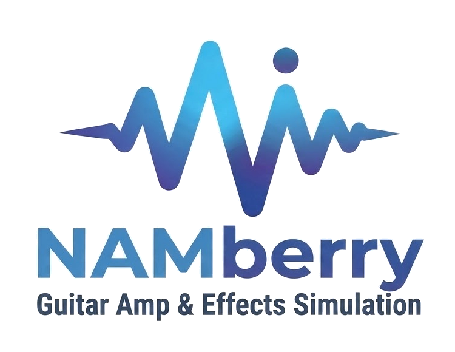
</picture></p>

<p align="center">
  <a href="LICENSE"></a>
  
  
  
  
</p>

# NAMberry

A bare-metal guitar multi-effects processor for the **Raspberry Pi 5** with a **Blokas Pisound** audio interface. It runs on [Circle](https://github.com/rsta2/circle) (no Linux), is controlled from a web page over Wi-Fi, and can run Neural Amp Modeler (NAM) captures next to a set of effects, many of them modelled from the schematics of real pedals.

> **Status: experimental, one-person project.** It was developed and tested on a single board. Read the "Honest limits" in [EFFECTS.md](EFFECTS.md) before trusting any effect to sound like the pedal it is named after.

## How it works

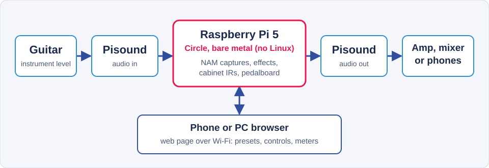

The guitar goes into the Pisound, the Raspberry Pi 5 processes it and the result leaves through the Pisound again. The pedalboard is edited from any browser on the same Wi-Fi network; the browser is not in the audio path.

**Why bare metal.** The firmware runs on [Circle](https://github.com/rsta2/circle) with no operating system, so no scheduler, background service or driver other than the firmware's own competes for the audio core. The figures in "Measured figures" below show what this gives: 1.083 ms calculated guitar-to-amp latency with the default 4-frame blocks, and on the running board 3,788,670 blocks since boot with 0 late and 0 faults. These numbers come from one board; no head-to-head measurement against a Linux setup is published here.

## What it does

* **Pedalboard grid** (6 rows x 12 columns): place blocks, drag them, draw links between them (series, parallel, splits, mixes), left/right routing, two inputs and two outputs.
* **Blocks**: about 60 effects (a few of them are new building blocks such as ADELshifter Manual and ADELSecondHand), listed in alphabetical order in the add menu (see [EFFECTS.md](EFFECTS.md)), a NAM block, cabinet impulse responses, EQ, delays, reverbs, modulation, dynamics.
* **NAM models** in A2 WaveNet form, converted to a compact `.adn` file by `tools/nam2adn.py` and run by the ADELnam engine (`adelnam_engine.hpp`), which is written for this project (no third-party code in the firmware).
* **Web page** served by the board: presets, per-block controls and meters, model/IR library upload, MIDI settings, service functions, temperature and fan control.
* **Seamless preset change** (the old preset's delay and reverb tails keep ringing while the new one starts).
* **MIDI** over USB (DIN input is present in the code but disabled by default because it is untested on hardware).
* **Updates over Wi-Fi** (signed with an HMAC key stored on the SD card, `ota.key`), a **fallback WPA2 access point** when the home network is missing, and a **concert mode** that boots without any network.
* **DI recorder**: records the raw input (24-bit stereo) into memory and downloads it as a WAV file from the page.
* **Live Display**: an optional wired touch display (an ESP32 board, 2.8" or 4.0", one USB cable, no Wi-Fi needed while playing) to see and switch blocks, change presets, edit parameters and NAM models, and build a simple preset. See [docs/live-display.md](docs/live-display.md).

## Screenshots

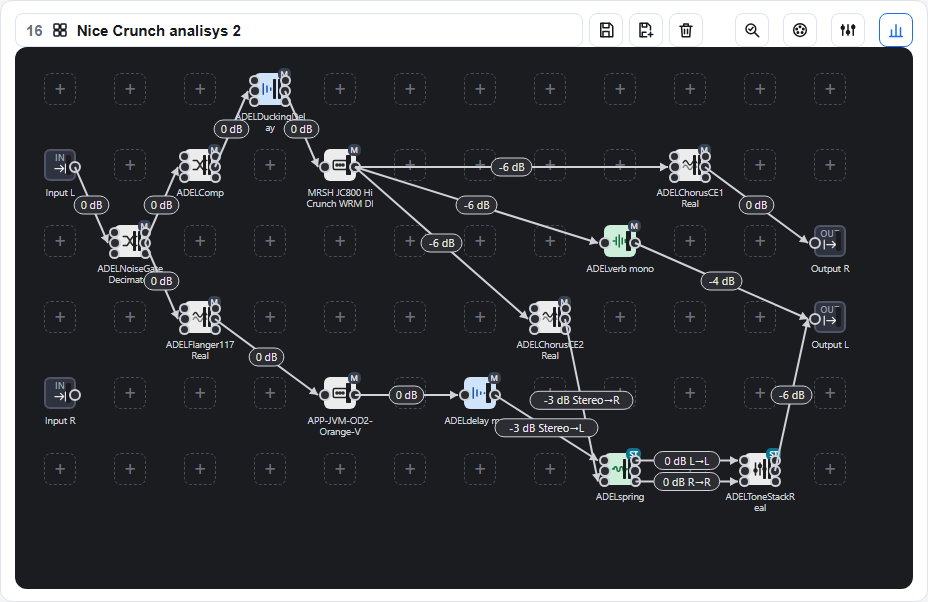

*The web page served by the board, showing a test preset with two NAM captures, compressor, noise gate, MXR 117 flanger, Boss CE-1 and CE-2 chorus models, ducking delay, delay, reverb, spring reverb and tone stack, linked with series, parallel and stereo routes.*

**Moving a block**: press a block and drag it to another cell; the arrows follow.

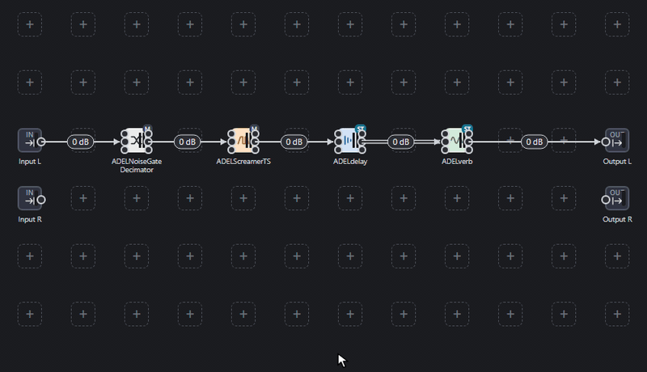

**Drawing an arrow**: drag from a block's output port to another block's input port (here from the Screamer to the delay, then from the reverb to the output).

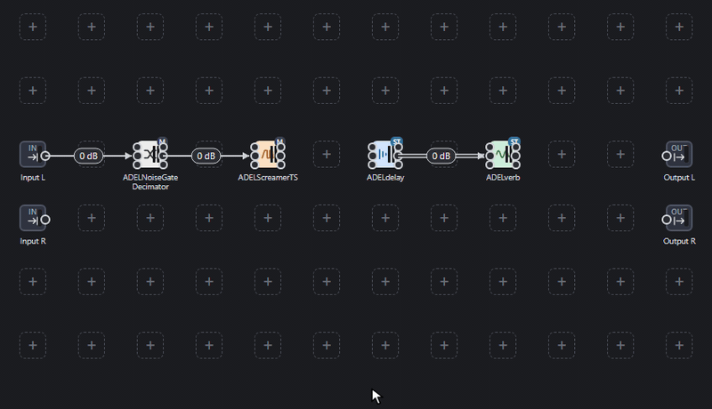

**Removing a block**: press and hold a block for about 0.6 s; a copy button and a trash button appear over it. Tap the trash to remove it (its arrows go with it).

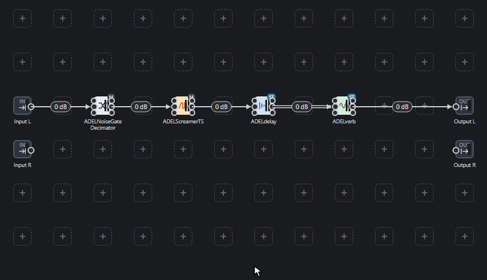

**Copying and pasting a block**: the same long press, then the copy button. Long-press an empty cell and a paste button appears; the copy keeps the type and the settings of the original and is pasted as a new block with no arrows.


*All four animations were recorded from the real web page, served by a local test server with a small demo pedalboard (no board attached), driven by a scripted mouse.*

## Measured figures

Measured on 2026-10-21 with firmware build `mcore92` on a Raspberry Pi 5 (48 kHz, 4-frame blocks). What was measured and what was only calculated is stated for every number.

### Quality

| What | Result | How |
|---|---|---|
| ADELnam engine against the NeuralAudio reference (A2 WaveNet, full quality) | relative error -128 to -118 dB (float32 rounding level) | `AdnCompare` on two models and three test signals (glissando, plucked notes, loud noise), run on a Pi 5 under Linux |
| Tube Screamer circuit model against real TS9 captures | 0.42 dB rms, 40 Hz - 10 kHz, small signal | nine TONE3000 captures; the model has four free parameters |
| RAT circuit model against real RAT captures | 1.49 dB rms over 294 points | fitted to 14 TONE3000 captures (so this is a fit, not an independent check) |
| LA-2A style optical compressor | 0.5 - 0.6 dB gain-reduction error on music | fitted to SignalTrain recordings; about 1.2 - 2.2 dB off on noise not used in the fit |
| All the other circuit models | not compared with recordings of the real pedals | see [EFFECTS.md](EFFECTS.md) for sources and assumptions |
| Automated tests | 35 host test steps and 13 web-page tests, all passing | run as part of the `mcore92` build |

### Latency

| Block size | Block period | Guitar-to-amp latency (calculated) |
|---|---|---|
| 2 frames | 41.7 us | 1.000 ms |
| **4 frames (default)** | **83.3 us** | **1.083 ms** |
| 8 frames | 166.7 us | 1.250 ms |
| 16 frames | 333.3 us | 1.583 ms |

The latency is calculated, not measured with a loop-back cable: two blocks plus 44 frames of converter filter delay, the same figure the web page shows. A measured round-trip with a physical loop is still to do.

### CPU

Share of the audio core's time per block (Pi 5, 4-frame blocks, benchmark under Linux, mean of a 3 s run):

| NAM models running (A2, 8 channels) | ADELnam engine | NeuralAudio reference |
|---|---|---|
| 1 | 5.5 % | 12.9 - 13.7 % |
| 2 | 11.2 % | 27.4 - 28.9 % |
| 3 | 17.2 % | - |

On the running board with a test preset (one NAM, eleven other blocks, four cores in use): average CPU 24.5 %, peak 30.0 %, no overruns, SoC temperature 57 C (one reading). Worker-core statistics since boot: 3,788,670 blocks, 0 late, 0 faults.

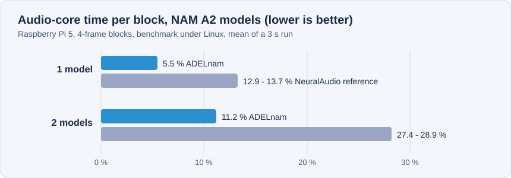

### Space

| What | Size |
|---|---|
| Firmware image (`kernel_2712.img`) | 1,551,088 bytes |
| Room left below the kernel limit (end of the image and its zeroed data must stay under 0x280000) | 266,784 bytes |
| One NAM A2 model as `.adn` (8 channels, 23 layers, 12,146 weights, receptive field 6,347 samples) | 48,880 bytes |
| A library of 282 models | about 13.8 MB (calculated: 282 x 48,880 bytes) |
| Web page as served (gzip) | 63,364 bytes (source `control_page.h` is 190 KB) |
| DI recorder buffer | up to about 236 MB for 614 s of 24-bit stereo (stored as 32-bit words), allocated only while a recording exists |
| Free heap reported by the firmware after boot | about 4.1 million KB |
## Features in detail

### Pedalboard and blocks

* A 6 x 12 grid. Drag from a block's output port to another block's input port to draw an arrow; the level on every arrow can be changed (in dB) and arrows can run diagonally. Series, parallel branches, splits and mixes are all just arrows. There are two inputs and two outputs.
* Press and hold a block for about 0.6 s and a trash button appears over it; tap it to remove the block.
* Every block has its own panel with the controls grouped in sections and a "Saved settings" menu for block presets (the author's board holds 239, installed with `tools/block_presets.py`: four for every effect, about 45 of them with values from manuals, articles and forum posts (ZVEX Fuzz Factory manual, Tube Screamer and Big Muff settings of famous players, The Edge's dotted-eighth delay, slapback times, reverb decay guides and others); the rest are marked `(typical)` and are starting points built on how the controls are described, not documented settings of a player. Every source and every assumption is in `presets_fonti.txt`).

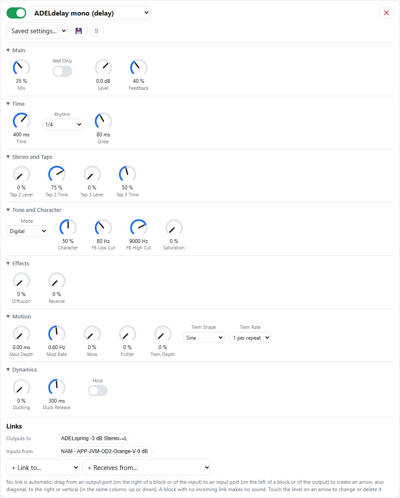

### Preset analysis

The magnifier button next to the preset name opens an analysis of the preset. **It does not listen to the sound**: it reads the structure of the pedalboard and tells you, block by block, what looks wrong, why, and what to do about it, with buttons that select the blocks involved and an "Ignore" button for advice you disagree with (remembered per preset). It checks:

* **Routing:** no input or no output connected, blocks that receive no signal or whose output goes nowhere (a NAM or Cab IR in that state is not computed, so it does not use CPU), blocks that are switched off, a stereo block that ends on a single output, one output channel left silent.
* **Levels:** the estimated gain from input to output, based on the arrows' dB and the Volume and Pan controls; a warning when the signal is very low. For every NAM block it compares the input level you set with the level the capture was made at and warns when it is far off.
* **Phase between parallel branches:** when two branches that contain different amp or cabinet models start from the same signal and are summed again, they can cancel each other (comb filtering). The analysis explains where the first notch falls for a given delay and offers the measurement below.
* **Order and tone advice** for a guitar chain: reverb or delay placed before a NAM, no cabinet or equalizer after a NAM when the output goes to headphones or a mixer, a high cut left open after a distorted sound, a boost in the 200-500 Hz "mud" zone, a treble shelf after distortion, high gain without a noise gate. The "After the output there is" selector tells it whether a power amp and cabinet follow (then it does not suggest cabinet or EQ). Every piece of advice cites the forum posts, articles or manuals it comes from; these are indications from players' experience, not measurements.
* **Measure the phase:** a button that does by itself what used to be done by hand. It adds a probe block (`ADELSendSweep`) and `ADELphase` to the preset, plays a 10-second sweep with the output muted, reads the verdict (phase OK, invert the polarity of one branch, delay branch A or B, the paths are not correlated, phase rotation) and, if you press "Apply the correction", writes the delay and polarity into `ADELphase`. It then measures again to confirm and puts the preset back as it was.

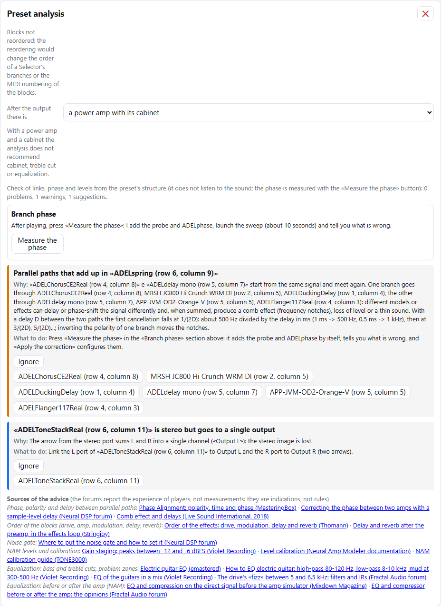

### Harmonizer and the two blocks built around it

**ADELshifter** is a three-voice harmonizer for single notes (diatonic voices that follow a scale, or fixed semitones). Its pitch tracker was reworked: an attack detector limits the analysis window to the new note, the note that is sounding keeps its pitch while its period still fits, and an octave leap without a new attack needs many agreeing readings. On the synthetic bench in `tools/tracker` the notes reported shorter than 50 ms fell from 65 to 13, the note changes from 184 to 133 for 160 real notes and the latency of picked notes from 27 to 18 ms; chords are still not followed as well as single notes. Five presets named "Track 1..5" are made to try it.

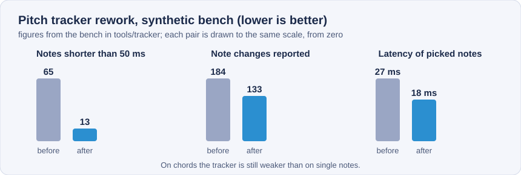

**ADELshifter Manual** is for when you want to decide every harmony yourself, note by note, and have the block remember it.

* It is the same engine with three Chromatic voices (each one a fixed number of semitones above or below the note you play) and a memory of 12 notes: one entry per note name, the same for every octave.
* The **Notes** section shows the note you are playing ("Playing: A2", the last note heard is kept). Every voice has a switch, down and up arrows (hold to repeat), the interval and the note it makes ("+7 semitones → E3") and a **volume** slider, so you can decide how loud each voice is.
* Play a note, listen, move the voices with the arrows until the harmony is right, then press **Save note**: the three settings are stored under that note name. Play the next note, adjust, save again. Every saved note gets a small button with its name: select it to change its setting (the arrows edit it while you hear the result) or press **Delete this note**.
* A note without a saved setting uses the semitones shown while no saved note is selected, so you can build each new note starting from the previous one.
* The memory is saved with the block, so it is kept in the preset and in the block's "Saved settings".
* Limits: a single note at a time (the tracker is monophonic), one entry per note name rather than per octave; the Glide control decides how a voice slides between notes.

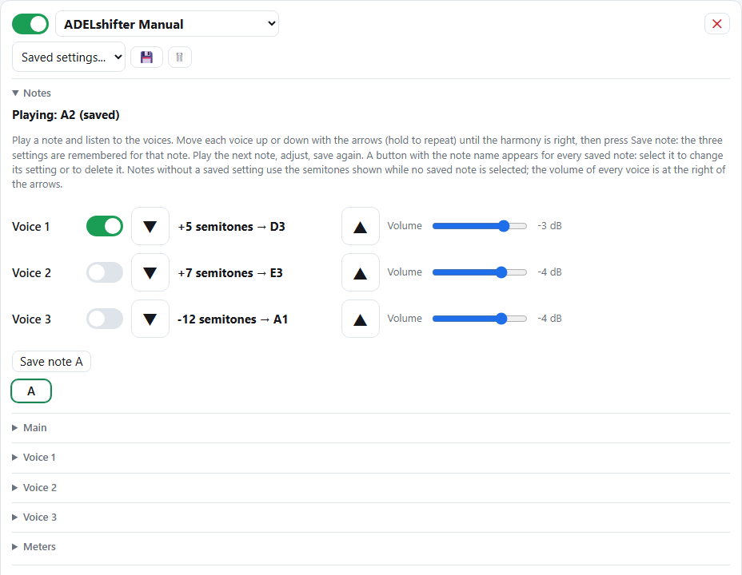

**ADELSecondHand** simulates a second guitarist playing the same notes or chords like an overdub, not a plain doubler: the little differences of a second take change from one note to the next.

* **Outputs**: *Clean | Hand* sends the guitar unchanged to the left output and the second guitarist to the right one; *Hand | Hand* sends hand 1 to the left and hand 2 to the right. Put a NAM on each output (they are distorted separately, like two real takes) and pan them. With *Hand | Hand* and the clean guitar linked straight from the input with one more arrow you get **three NAMs from one block**. Using the two hands through a single NAM would distort them together, which is cheaper but less convincing.
* **Timing**: every hand plays a little late (offset, up to 60 ms; the clean guitar cannot be anticipated while you play) and the delay is different at every new note (looseness, up to 40 ms). The change is made at the attack with a short crossfade, so there is no pitch glide.
* **Pitch**: a slow, irregular drift of a few cents, sharp and flat around the original, different for each hand (Pitch drift and Drift speed). A fixed detune would need processing synchronised to the pitch, so it is not offered.
* **Playing**: how much louder or softer each note can be (Dynamics), a tilt of the tone and how much it changes at every note (Tone, Tone variation), and a short burst of pick and string noise at the attack (Pick noise).
* **Attack sensitivity** is the level above which a rise of the signal counts as a new note; **Take** picks a different series of random differences (Take 1, 2, 3... are three different performances).
* Limits: a chord has one attack, so all its notes move together; it works on the signal before the NAM (the DI), and the realism is judged by ear, not measured.

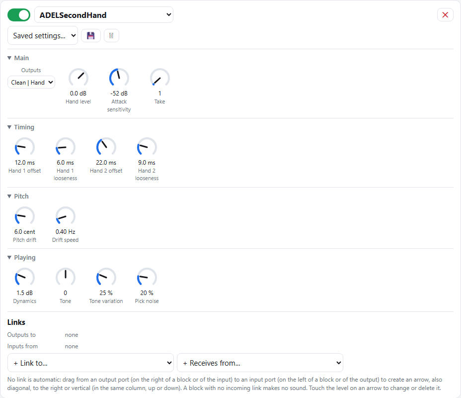
### NAM models

A2 WaveNet captures run in the ADELnam engine. Each model's input level is set from the metadata of the capture (`input_level_dbu`) and the interface's measured maximum level; bass, mid and treble controls and a per-block level offset are available. Models are uploaded from the page into the library, with an author/license note stored next to each one.

### Playing live and keeping it running

* **Seamless preset change**: the tails of the old preset's delays and reverbs keep ringing while the new preset starts, and the NAM states, model files and parsed presets are cached so a change takes a few milliseconds.
* **Concert mode**: boots without Wi-Fi or page, for the safest condition on stage. It can be entered and left with the Pisound button (hold for 3 seconds).
* **Fallback access point** and **updates over Wi-Fi**, signed with a key on the SD card.
* **Fan and temperature control**, and a safe mode when the boot is not clean.

### Tools

* **DI recorder**: records the raw guitar input (24-bit stereo) in memory, up to about 10 minutes, and downloads it as a WAV file; several takes can be added one after the other (a small .csv file says where each starts). It is meant to build test material, for example for a note tracker.
* **Measurement tools** as blocks: `ADELSendSweep` (sweep, guitar notes, chord or pink noise at the press of a button) and `ADELphase` (polarity, delay, all-pass and phase measurement between two channels).
* **Service functions** that can be switched on and off from the page: hum, rumble, limiter, mono, air, saturation, click, RTA, tuner and meter.

## Live Display

A small touch display for playing live, connected to the Pi's USB port with one cable: the **Stage** screen shows the preset and the blocks as coloured tiles (tap to switch a block, hold to open its knobs, `<` `>` to change preset, level bars at the sides), the knobs and an editor with a slider and an Undo button change the parameters and the NAM model, and a "+" in the preset list builds a simple one-lane preset and saves it. Two Freenove boards are supported, one at a time on the cable: the ESP32-S3 2.8" (FNK0104B, capacitive touch) and the ESP32 CYD 4.0" (FNK0114S, resistive touch, through a CH340). The firmware is in `display/`, it is updated over Wi-Fi, and the screen can be rotated to landscape.

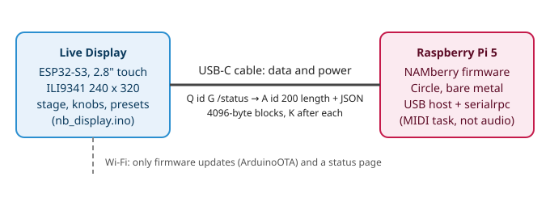

The hardware specification (pins, screen, touch, what was found and what was not), the serial protocol and its flow control, how to build and load both sides, the measured figures and the limits are in **[docs/live-display.md](docs/live-display.md)**. It was tried on one unit; the audio latency with the display attached has not been measured again.

## Hardware

* Raspberry Pi 5
* Blokas Pisound (I2S audio, MIDI)
* microSD card with Circle's boot files and Wi-Fi firmware (see "Not included")
* A fan on the Pi 5 header is supported (PWM)
* Optional: the Live Display (Freenove ESP32-S3 2.8" or ESP32 CYD 4.0" touch display, one USB cable), see above

<p align="center">
  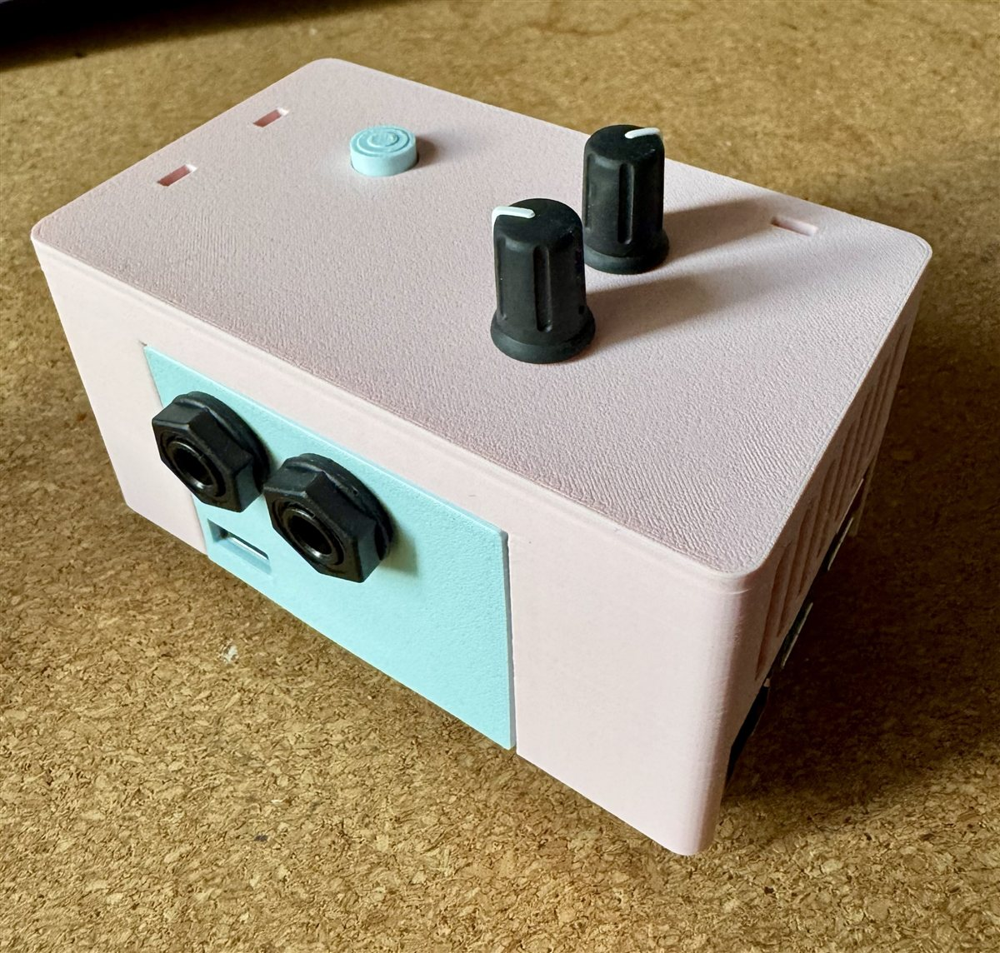
  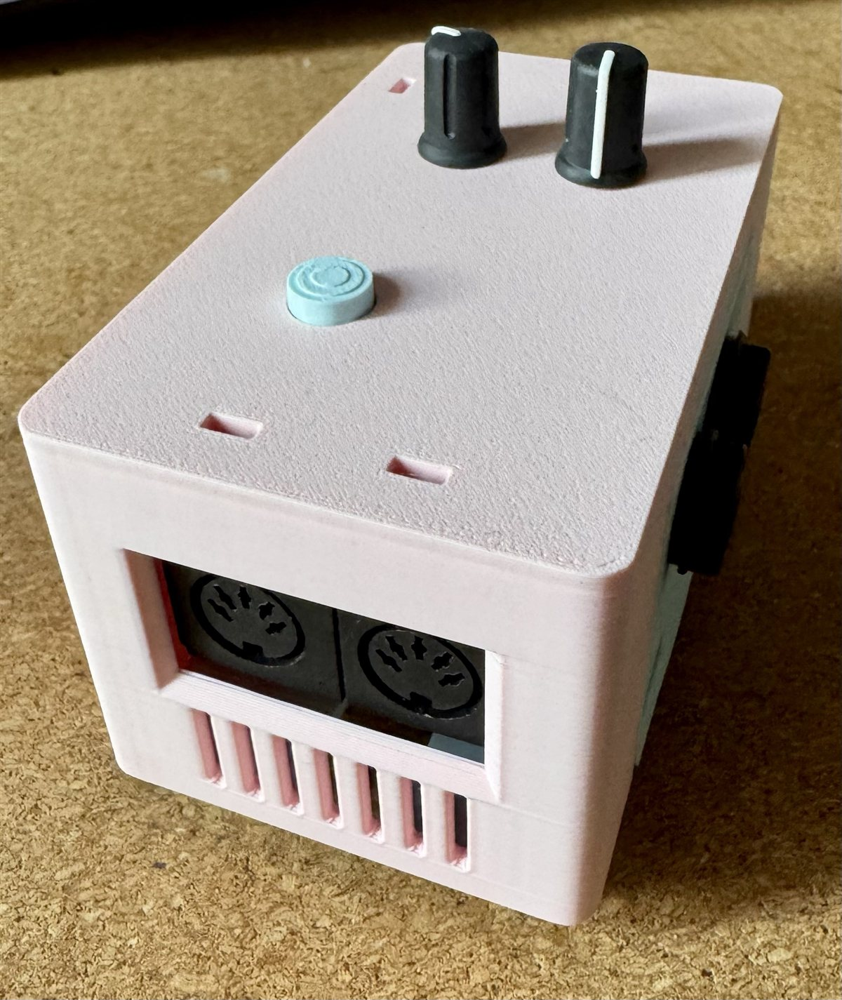
  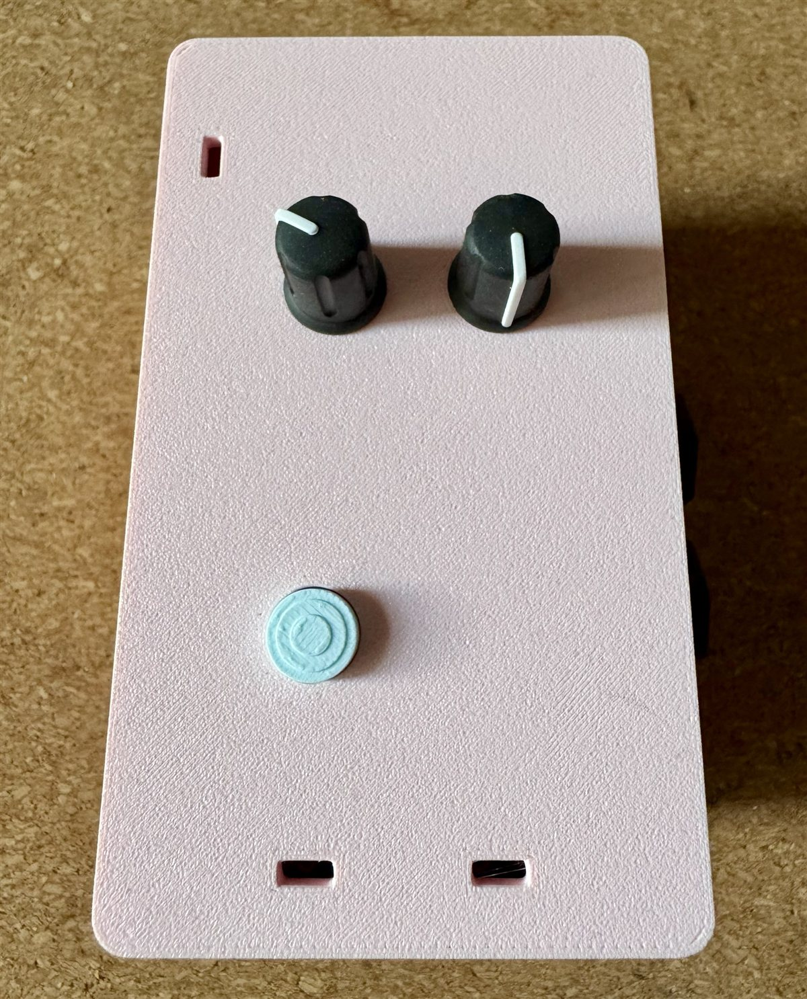
</p>

*The author's enclosure: two jack sockets on the front panel, two 5-pin DIN sockets and ventilation slots on one end, two knobs and a button on the lid. The firmware's DIN MIDI input is disabled by default (see above); the knobs and the button are not described here because their functions are not documented in this repository.*

## Building

You need an `aarch64-linux-gnu` cross toolchain (or build on a Pi 5) and Circle.

1. Clone Circle at the commit this project was built against and apply the patch:
   ```
   git clone https://github.com/rsta2/circle.git
   cd circle
   git checkout 7a81e1b480fe7d19fc1fc695b89bff0a0848f44b
   git apply /path/to/NAMberry/circle-patches/circle-namberry.patch
   ```
   The patch contains the changes made to Circle (RP1 I2S/DMA buffer alignment and cache handling, Wi-Fi access point support, exception-handler diagnostics, `ARM_ALLOW_MULTI_CORE` enabled and `MAX_TASKS` raised to 48, and the USB CDC driver change needed by the Live Display).
2. In Circle's `Config.mk` set `PREFIX64 = aarch64-linux-gnu-`, `AARCH = 64`, `RASPPI = 5`, then build Circle and the add-ons used by the Makefile (`addon/wlan`, `addon/fatfs`, `addon/SDCard`, `addon/tftpfileserver`, `lib`).
3. Copy this repository to `circle/addon/wlan/sample/pisound-wifi-test`.
4. Copy `config_local.h.example` to `config_local.h` and put the address of your PC (syslog and OTA).
5. Run `make`. The result is `kernel_2712.img`.

## Repository layout

```
Makefile              builds the firmware (inside Circle's tree, see Building)
config_local.h.example  copy to config_local.h and edit
src/                  the firmware: web server, pedalboard engine, effects (fx_*.cpp), MIDI, updates
src/adel/             the DSP engines of the ADEL family (reverb, delay, harmonizer, ...)
src/fxshim/           small replacements of the C++ library headers used by the engines on the bare-metal side
display/              the Live Display: firmware (nb_display.ino), bring-up sketches, a test tool
tests/                host tests (test_*.cpp), web page tests (test_*.js), host_shim/
tools/                nam2adn.py (NAM to .adn), block_presets.py (block settings), tracker/ (pitch tracker bench), mkpagegz.py
docs/                 screenshots and the sources of the block settings
circle-patches/       the changes made to Circle
EFFECTS.md  NOTICE.md  LICENSE
```

## Tests

Host tests need no board: `tests/run_host_tests.sh` compiles every `tests/test_*.cpp` with g++ (the repository must sit at `circle/addon/wlan/sample/pisound-wifi-test`, so that Circle's headers are found) and prints one result line per test; `tests/run_page_tests.sh` checks the web page with Node.js.
## Not included

* **Wi-Fi firmware blobs and Circle boot files**: take them from Circle's distribution (Broadcom/Raspberry Pi license, see [NOTICE.md](NOTICE.md)).
* **NAM models, captures and impulse responses**: bring your own and respect their authors' licenses.

## Contributing

Bug reports, questions and ideas are welcome as [GitHub issues](https://github.com/Vants5150/NAMberry/issues); see [CONTRIBUTING.md](CONTRIBUTING.md) for what helps most. This is a one-person project tested on a single board, so reports that say which board, build (the page shows it) and preset were used are the most useful.

## License

Copyright (C) 2026 VanTs. Released under the GPL-3.0, see [LICENSE](LICENSE). Third-party components and the sources used for the circuit models are listed in [NOTICE.md](NOTICE.md).

Product names are trademarks of their owners and appear only to say which circuit an effect models. The project is not affiliated with or endorsed by them.
